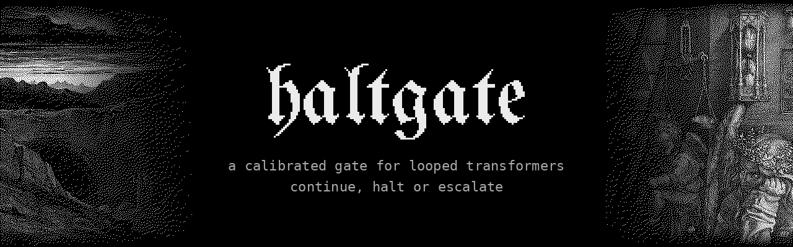
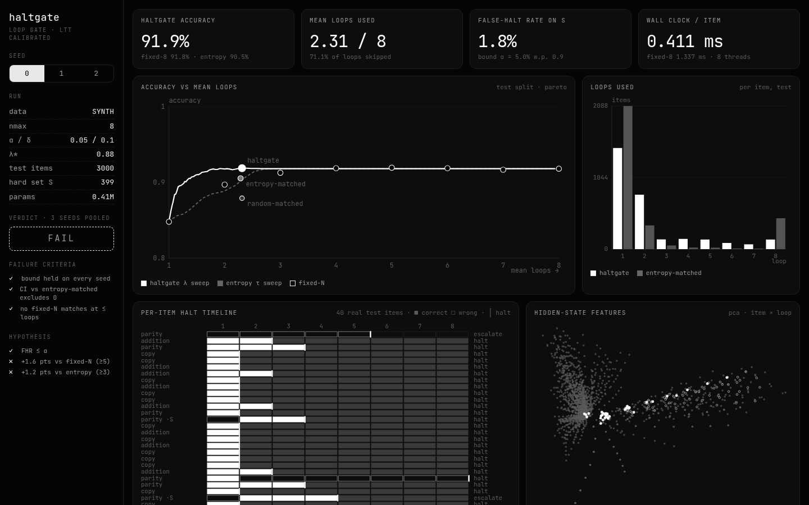
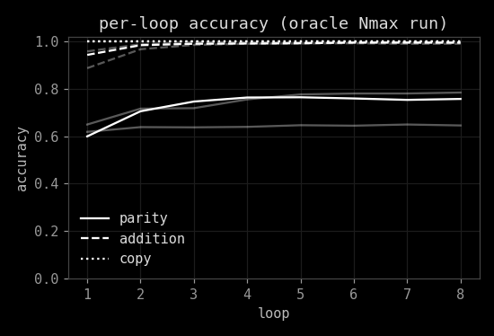
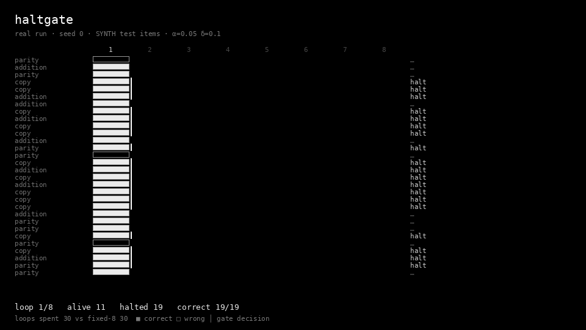
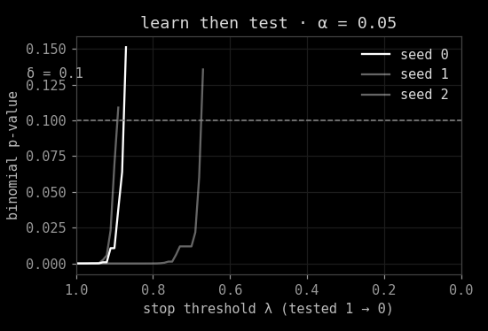
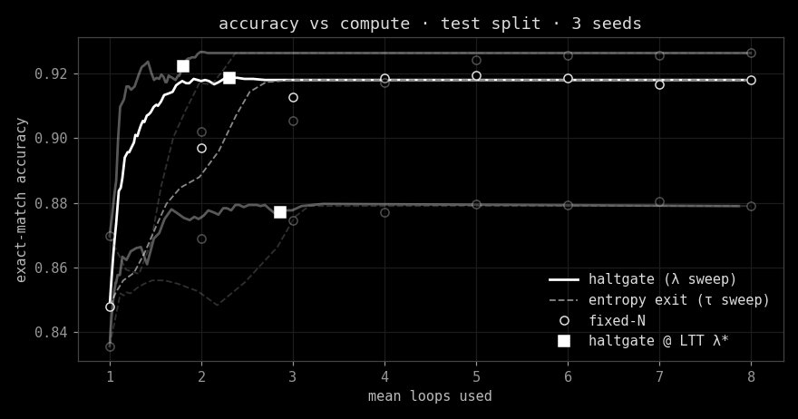
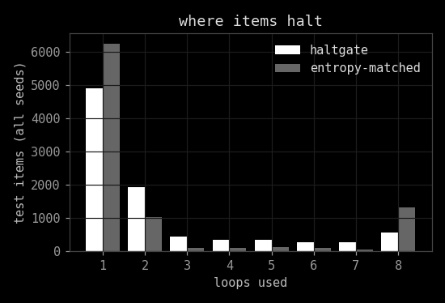

haltgate is a loop gate for a tiny shared-block looped transformer. After every pass it reads a few cheap
hidden-state features and a typed decision model picks one of `{continue, halt, escalate}`. A Learn-then-Test
calibration keeps the rate of halting items that would still improve below alpha, with probability 1 - delta.

Everything here is small, CPU-only and on generated (SYNTH) toy tasks. The pre-registered verdict is **FAIL**:
the bound held and the gate skipped 71% of loops at near-Nmax accuracy, but the required 5-point gap over fixed-N
was not reachable on this suite. Details in [docs/REPORT.md](docs/REPORT.md).

    

`#ai-frontier-research` `#looped-transformers` `#decision-models` `#conformal-prediction` `#early-exit`
`#adaptive-compute` `#system-one` `#cpu-inference` `#typed-decisions` `#policy-gates`



## The Loop

The backbone is one shared block of two pre-norm transformer layers (d=128, 4 heads, 0.41M parameters) applied up
to Nmax = 8 times, with the input embedding re-injected before each pass. It is trained from scratch on CPU with
deep supervision on every loop, on three generated tasks: parity of up to 16 bits, multi-digit addition, and
copy-with-noise (recover a string from three corrupted copies).

Copy is solved in one pass. Addition mostly in two. Parity keeps improving for a few loops and then plateaus.
That shape matters more than anything else below.



## The Gate

After each loop the gate sees the mean-pooled hidden state plus six scalars: loop index, mean and max answer-slot
entropy, min slot confidence, relative delta-norm between passes, and the fraction of slot predictions that flipped.
No labels. A multinomial logistic regression maps that to a simplex over `continue`, `halt`, `escalate`; it stops
when `1 - p(continue) >= lambda`, and the larger of the two stop scores names the decision.

Oracle labels come from running every train item to Nmax offline: `continue` if it is wrong now and right later,
`halt` if it is right, `escalate` if it is never right. `escalate` stops and flags the item; v1 has no deeper path.



## The Bound

Learn-then-Test picks lambda on a held-out calib split. The hard set S is the items that still improve at a later
loop; a false halt is stopping one of them early. Thresholds are tested from strict to loose with exact binomial
p-values against alpha = 0.05 and stop at the first failure (fixed-sequence testing), giving a false-halt rate on S
<= alpha with probability >= 0.9. If no threshold passes, the gate runs Nmax.

Test false-halt rate on S was 1.8%, 3.8% and 4.8% across seeds. The bound held every time.



## The Results

Three seeds, 3000 test items each, pooled. Arms: fixed-N, entropy early-exit at matched mean loops, entropy
early-exit with the same LTT calibration, random halting at the gate's loop distribution, and haltgate.

<!-- results:start -->
| arm | accuracy | mean loops | false-halt on S |
|---|---:|---:|---:|
| fixed-1 | 85.1 ± 1.4 | 1.00 | 82.0% |
| fixed-2 | 88.9 ± 1.5 | 2.00 | 42.9% |
| fixed-3 | 89.8 ± 1.6 | 3.00 | 25.4% |
| fixed-4 | 90.4 ± 1.9 | 4.00 | 15.0% |
| fixed-5 | 90.8 ± 2.0 | 5.00 | 9.8% |
| fixed-6 | 90.8 ± 2.0 | 6.00 | 5.9% |
| fixed-7 | 90.8 ± 2.0 | 7.00 | 2.8% |
| fixed-8 | 90.8 ± 2.1 | 8.00 | 0.0% |
| haltgate | 90.6 ± 2.1 | 2.32 | 3.4% |
| entropy-matched | 89.4 ± 1.8 | 2.32 | 11.9% |
| entropy-ltt | 90.2 ± 2.1 | 2.54 | 4.4% |
| random-matched | 87.2 ± 1.2 | 2.32 | 57.4% |

Gap of haltgate vs baseline at matched loops, pooled over 9000 test items (95% bootstrap CI, points):

- vs fixed-interp: +1.6 [+1.0, +2.1]
- vs entropy-matched: +1.2 [+0.9, +1.5]
- vs random-matched: +3.4 [+2.8, +3.9]

Verdict: **FAIL** (failure criteria: none triggered; hypothesis parts not met: h2a_gap_vs_fixed_ge_5pts, h2b_gap_vs_entropy_ge_3pts).
<!-- results:end -->

The gate wins at matched compute, with CIs clear of zero. It does not win by much, because there is not much to
win: fixed-8 is only about 1.6 points above fixed-N at 2.32 loops, and the gate recovers nearly all of that.

| | |
|---|---|
|  |  |
|  |  |

## Install

```sh
git clone https://github.com/Sebastianrodaaa/haltgate && cd haltgate
pip install --index-url https://download.pytorch.org/whl/cpu torch && pip install numpy matplotlib pillow
python3 test_haltgate.py     # ~10 s, uses the committed seed-0 checkpoint
make repro                   # re-evaluate all arms from checkpoints/, rewrite results/ and plots
make app                     # dashboard on http://localhost:8765
make train                   # retrain 3 seeds from scratch (~1 h on 8 vCPU)
```

It writes only inside the repo: `checkpoints/`, `results/`, `docs/screenshots/`, and the results block in this
README and the report. `git checkout -- .` undoes a rerun.

## The Name

A halt gate is the stop line on a railway: the point where a train either gets another block of track or waits.
Here each loop is a block, and the gate decides whether the item has earned the next one.

## Inspirations

Looped and universal transformers, ACT and PonderNet for learned halting, CALM and Learn-then-Test for calibrated
early exit, and decision models as typed policy gates. Links and notes in [INSPIRATIONS.md](INSPIRATIONS.md).
README layout after [athanor](https://github.com/ghgoodreau/athanor).

## License

MIT, see [LICENSE](LICENSE). Third-party art, fonts and libraries in [NOTICE.md](NOTICE.md).
